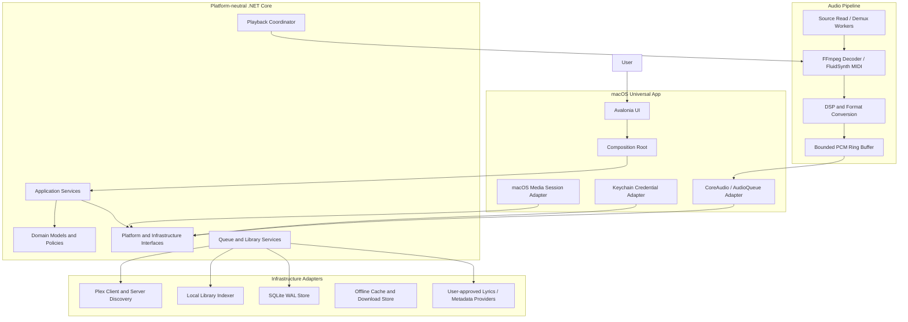

# Auralita Architecture and Technical Plan

This plan translates [spec.md](./spec.md) and
[clarifications.md](./clarifications.md) into a macOS-first architecture. It
preserves the platform-neutral core boundary while leaving explicitly
unconfirmed product decisions open.

## 1. Architecture Overview

### 1.1 System Diagram



The diagram shows logical ownership and dependencies, not a required one-class
per-box implementation. The composition root wires implementations into ports;
the core must not reference Avalonia, Plex transport details, SQLite, or
platform frameworks.

### 1.2 Dependency Rules

1. UI and platform adapters depend inward on application contracts.
2. Application services depend on domain types and ports, never concrete
   infrastructure implementations.
3. Infrastructure adapters implement ports and may depend on the core's public
   contracts.
4. Audio device callbacks communicate with preallocated audio buffers only;
   they must not call UI, persistence, network, logging, or decoder APIs.
5. Credentials and native handles must not appear in domain entities or
   persisted records.

## 2. Technology Stack Decisions

| Area | Baseline decision |
| --- | --- |
| UI and application | Avalonia UI with a compiled .NET desktop application. No Electron or embedded web-app shell. |
| Runtime and language | Initial implementation pins .NET SDK `10.0.404` and C# 14, with NativeAOT support for macOS `arm64` and `x86_64`; nullable reference types and warnings-as-errors are enabled. Reassess the release SDK only through an explicit dependency decision. |
| UI package baseline | Avalonia `12.2.0` for the desktop app; package versions are centrally pinned in `Directory.Packages.props`. |
| Audio decoding | FFmpeg (`libavformat`, `libavcodec`, `libswresample`) through a NativeAOT-compatible interop boundary. |
| MIDI | FluidSynth with an explicitly licensed, redistributable SoundFont selected before packaging. |
| macOS audio output | CoreAudio or AudioQueue behind `IAudioOutputBackend`; validate per-device and system-routing behavior on target macOS. |
| macOS media controls | MediaPlayer.framework through a narrow adapter for remote commands and Now Playing publication. Use supported system APIs for routing; do not assume MediaPlayer implements all routing features. |
| macOS secrets | Security.framework / Keychain behind `ISecureCredentialStore`. |
| Local persistence | SQLite in WAL mode using `Microsoft.Data.Sqlite`; deterministic, forward-only migrations. Validate provider and native dependency compatibility with NativeAOT. |
| Local search/index | SQLite-backed metadata index and a background filesystem scanner. Start with indexed metadata queries; add a separate search engine only if measured requirements justify it. |
| Packaging | Universal `.app` with `arm64` and `x86_64` slices, hardened runtime, minimal entitlements, signing, notarization, and `.dmg` distribution. |
| Build and CI | CLI-driven `dotnet build`/`dotnet test` and reproducible native dependency scripts. CI provider is not fixed by the source documents; whichever is selected must build/test both macOS architectures and produce release evidence. |

No Avalonia, FFmpeg, FluidSynth, or .NET major-version upgrades should be used
as unverified workarounds. Pin dependency versions and document upgrade
reproduction and rollback.

## 3. Module and Component Breakdown

Suggested solution projects; exact project names can follow the repository's
existing conventions.

| Component | Responsibility | Must not own |
| --- | --- | --- |
| `Auralita.App` | Avalonia views, view models, navigation, user interaction, UI dispatch, and desktop composition root. | Plex protocol, audio callback work, database access. |
| `Auralita.Core` | Domain entities, application services, playback/queue policies, ports, and platform-independent validation. | Framework/UI types, native handles, direct HTTP or SQL implementation. |
| `Auralita.Audio` | Playback orchestration, bounded buffering, decoder/DSP lifecycle, format negotiation, seek and error handling. | UI updates, persistence, network I/O on callback path. |
| `Auralita.Audio.Native` | FFmpeg and FluidSynth bindings/loading, native library resolution, interop-safe types, and decoder adapter implementations. | Product policy or UI. |
| `Auralita.Infrastructure.Plex` | Plex PIN OAuth orchestration, server discovery, local/relay selection, library access, timeline/scrobble reporting, and capability detection. | Storing credentials outside the credential-store port. |
| `Auralita.Infrastructure.Library` | Watch-folder access, file metadata extraction, incremental scan scheduling, and local catalog adapter. | Editing or deleting user media. |
| `Auralita.Infrastructure.Persistence` | SQLite connection setup, repositories, WAL configuration, migrations, integrity check, and database recovery. | Secret storage or network calls. |
| `Auralita.Infrastructure.Offline` | Download manifests, cache lifecycle, user-initiated deletion, and offline availability. | Bypassing source permissions or access controls. |
| `Auralita.Platform.macOS` | CoreAudio/AudioQueue, MediaPlayer, Keychain, device notifications, file access, and macOS composition adapters. | Cross-platform domain rules. |
| `Auralita.Tests` | Unit, contract, integration, and performance tests; codec golden-sample harnesses live in test assets or licensed external fixtures. | Shipping sample media in the app bundle unless separately approved. |

Windows and mobile adapters are future modules and are not part of the initial
macOS release. Their future implementations should satisfy the same core ports
(WASAPI on Windows and AAudio on Android); Linux is not a committed target.

## 4. Runtime Flows

### 4.1 Playback

1. A UI action invokes a playback application service.
2. The playback coordinator resolves a local or Plex source and configures the
   decoder and output format.
3. Bounded source-read/demux workers perform file or network I/O and feed
   compressed packets through bounded queues to a dedicated high-priority
   decode/DSP worker.
4. The decode/DSP worker processes packets and fills a bounded, preallocated
   single-producer/single-consumer PCM ring buffer. It must not perform source
   I/O; validate decoder deadline behavior on target hardware.
5. The platform audio callback consumes available frames and fills any
   underflow with silence; it performs no allocations, locks, disk I/O, network
   I/O, or logging.
6. Track transitions, seek completion, and errors are reported out-of-band to
   the coordinator, which updates application state and dispatches UI changes.

Decoding and DSP run on a dedicated high-priority worker, separate from the
device's real-time callback. The callback is kept short and lock-free. The
worker's OS scheduling priority and decoder deadline behavior must be validated
as specified by C-16; neither is a substitute for bounded queues and recovery.

On decoder failure, the worker reports a typed error and track identity. The
coordinator emits a non-blocking user notification and advances the queue,
targeting the specified 250 ms recovery. Device removal causes a clean pause,
position preservation, and stream release; rebinding/resume follows C-06.

### 4.2 Plex Connectivity and Timeline

- The Plex adapter obtains authentication material through the credential
  store; tokens are never written to SQLite or logs.
- Server discovery records capabilities and candidate connection routes.
  Prefer a reachable configured direct connection and fall back to Plex Relay
  where available.
- The adapter reports playback state transitions and timeline position to the
  selected server. Connectivity failures are surfaced as service status and
  retried according to an explicit bounded retry policy; they must not block
  local playback or the UI.
- Sonic, radio, lyrics, and metadata functionality is capability-gated. Only
  configured Plex endpoints and user-approved providers may be contacted.

### 4.3 Startup and Persistence Recovery

1. Open the SQLite database and run integrity validation before normal
   repository use.
2. If integrity validation fails, close active handles, preserve a
   timestamped corrupt copy, create a fresh database, and apply migrations.
3. Restore what can be reconstructed from available Plex servers and local
   watch folders; identify unavailable sources and retry later.
4. Keep local source files untouched. Do not silently report a complete sync
   when sources were unavailable.

## 5. Interface Contracts

All asynchronous contracts accept cancellation where work may block. Expected
operational failures use explicit result/error types or typed exceptions
consistent with repository conventions; they must not be converted to
success-shaped fallback values.

| Contract | Core-facing responsibility | Contract behavior |
| --- | --- | --- |
| `IAudioOutputBackend` | Enumerate/select outputs, negotiate sample format/rate/channels, open and close a stream, and expose device-removal notifications. | Opening returns the negotiated format and an explicit unsupported/error result. Callback access is bounded and allocation-free. Device loss reports an event; no callback performs rebind or UI work. |
| `IMediaSessionService` | Register/unregister play, pause, stop, next, previous, and seek commands; publish current Now Playing metadata and playback state. | Commands enter the same application playback service as UI commands. Registration is lifecycle-scoped. Metadata publication failures are observable but do not stop playback. |
| `ISecureCredentialStore` | Read, write, and delete credentials by opaque account/server key. | macOS implementation uses Keychain. Returned secret material is short-lived, never logged, and never persisted by callers. Missing credential differs from store failure. |
| `IPlexGateway` | Authenticate, discover servers, query library, retrieve stream sources, expose capabilities, and report timeline/scrobble state. | Network routes are limited to user-configured Plex/Plex.tv endpoints. Operations are cancellable and return typed authentication, connectivity, authorization, and service errors. |
| `ILibraryCatalog` | Query and update indexed tracks/albums/artists and watch-folder scan state. | Queries are local and do not wait on Plex. Upserts are idempotent; source file paths remain references and are not modified. |
| `ILibraryIndexer` | Add/remove user-approved roots and schedule initial/incremental scans. | Scans run in bounded background workers and report progress/errors without blocking UI or audio callbacks. |
| `IMusicRepository` | Persist and query library metadata, queue snapshots, playlist records, and scan state. | Uses transactions and deterministic migrations. Does not persist credentials or native handles. |
| `IOfflineContentStore` | Download/cache permitted content, report availability, open local content, and delete user-selected cached/downloaded items. | Distinguishes transient cache from retained downloads; honors resolved retention policy and source permissions. |
| `ILyricsProvider` | Retrieve lyrics from embedded tags or a user-approved provider. | Provider is opt-in/configured; local or embedded lyrics work without network access where available. |
| `IPlaybackClock` | Provide monotonic timing for playback and timeline reporting. | Avoid wall-clock jumps for seek/progress calculation; wall-clock timestamps are only for persisted event metadata where needed. |

### 5.1 Audio Data Contracts

- `AudioFormat`: sample rate, channel layout/count, sample representation, and
  interleaving.
- `PcmBuffer`: preallocated frame storage plus valid-frame count; ownership and
  lifetime are fixed for the duration of a callback.
- `TrackSource`: opaque source identity, source kind (local/Plex/download),
  duration/seek capabilities, and a way to open a cancellable read stream.
- `PlaybackState`: stopped, loading, playing, paused, seeking, or failed, with
  queue item identity and millisecond position.
- `AudioDeviceDescriptor`: stable backend identifier, display name, and
  capability information; no native pointer crosses the platform boundary.

The SPSC ring buffer has one producer and one consumer. Format changes and
device restarts occur through a control path while the stream is stopped or
quiesced, never by mutating callback-owned state unsafely.

## 6. Data Model

### 6.1 Domain Entities

- **Track:** stable ID, source ID, location/reference, title, duration,
  codec/format metadata, optional album/artist IDs, and availability state.
- **Artist / Album:** stable ID, display metadata, artwork reference, and
  source ownership.
- **LibrarySource:** source kind, user-selected root or Plex server/library
  identity, last scan/sync status, and capability metadata.
- **Queue / QueueEntry:** queue identity and ordered entries with track/source
  references, playback position, and repeat/shuffle state.
- **Playlist:** local or Plex-backed identity, title, ordered track references,
  and sync capability. Collaborative/smart behavior remains out of initial
  scope pending C-08.
- **PlaybackSession:** current queue entry, state, elapsed position, selected
  output identifier, and active processing mode; transient state is not a
  credential.
- **DownloadManifest:** source identity, local content location, size,
  completion/availability state, and user deletion state. It contains no
  authentication token.
- **Lyrics:** source track identity, format (LRC/embedded/provider), timed or
  untimed segments, language if known, and provider/source provenance.
- **AudioProfile:** user-selected output/DSP preferences such as ReplayGain,
  crossfade, EQ, and requested bit-perfect mode; effective mode is reported
  separately from requested mode.

Identifiers should be stable across rescans where a source provides a stable
identifier. File paths and Plex IDs are source-specific references, not
globally interchangeable IDs.

### 6.2 SQLite Tables and Relationships

Initial schema proposal:

```text
library_sources 1---* tracks *---0..1 albums
                              *---0..1 artists
queues          1---* queue_entries *---1 tracks
playlists       1---* playlist_entries *---1 tracks
library_sources 1---* scan_state
tracks          1---* download_manifests
tracks          1---* lyrics
```

Suggested tables: `library_sources`, `tracks`, `artists`, `albums`,
`queues`, `queue_entries`, `playlists`, `playlist_entries`, `scan_state`,
`download_manifests`, `lyrics`, `audio_profiles`, and `schema_migrations`.
Keep foreign-key and uniqueness constraints explicit; use transactions for
queue reorder and migration operations. Plex credentials, OAuth PINs, refresh
tokens, and passwords are never database columns.

Schema details, delete cascades, FTS strategy, artwork storage, and retention
policy are implementation decisions to settle during detailed design. Avoid
irreversible destructive migrations; migrations are forward-only and tested
from supported prior schema versions.

## 7. Security and Privacy Model

### 7.1 Assets and Trust Boundaries

- **Sensitive assets:** Plex credentials, local server credentials, user
  library paths, cached/downloaded media, playback history, and user-selected
  DSP preferences.
- **Untrusted inputs:** Plex responses, remote media streams, local file
  metadata, lyrics/provider responses, playlist contents, and malformed media.
- **Boundaries:** Avalonia UI to core; core to native decoder; core to
  Plex/provider networks; app process to filesystem; app process to Keychain;
  app process to CoreAudio and MediaPlayer.

### 7.2 Controls

- Store secrets only in macOS Keychain. Use opaque credential references in
  application/domain state; clear in-memory copies when no longer needed.
- Do not log tokens, PINs, authorization headers, secret query parameters, or
  full sensitive server URLs. Log enough non-secret context to diagnose failures.
- Restrict outbound requests to Plex.tv authentication, user-configured Plex
  servers/relay, and explicitly user-approved providers. Use TLS validation;
  do not add certificate pinning unless separately specified and operationally
  supportable.
- Request only required entitlements. Use user-selected file access for local
  library roots and read/write access only where needed for app-managed cache.
- Treat media and metadata as untrusted. Bound parsing, allocation, and
  processing; contain decoder failures and keep native calls behind validated
  adapters.
- Keep cache/download files under application-controlled storage with
  user-account filesystem protections. No additional cache-at-rest encryption
  is currently required by the specification; revisit if the threat model or
  stakeholder policy requires it.
- Include no third-party telemetry. Any future diagnostic export must be
  user-initiated, reviewed for secrets/paths, and separately approved.
- Audit licenses and provenance for native dependencies, SoundFonts, and test
  media before distribution.

### 7.3 Privacy-Safe Failure Handling

Operational errors are visible through non-blocking UI status or notifications.
The local, access-controlled diagnostic log includes the offending source URI
as required by FR-REC-1, with credentials and sensitive query parameters
redacted. User-initiated exports redact or omit personal paths unless the user
explicitly consents; logs are never sent automatically. Recovery must not
silently discard the corrupt database backup or imply remote sync success when
a source is unavailable.

## 8. Deployment Architecture

### 8.1 Build and Package

1. Restore pinned managed dependencies and reproducibly build/pin native
   dependencies for each macOS architecture.
2. Publish and test `osx-arm64` and `osx-x64` separately. Run unit and
   integration suites, codec golden tests, and NativeAOT compatibility checks
   on the relevant artifacts.
3. Assemble the universal `.app`; verify every bundled executable and native
   library has both slices and that runtime library paths resolve from within
   the app bundle.
4. Apply the minimum network-client and user-selected file access entitlements
   required by the app. Do not include audio-input entitlement unless a
   validated feature requires it.
5. Sign with hardened runtime, notarize, staple as appropriate, and package a
   `.dmg`. Release artifacts contain no credentials, provisioning profiles,
   or source-controlled native binaries.

Exact CI runner, signing-secret storage, certificate ownership, and release
approval workflow are not defined by the source documents and must be selected
by the project owner. Signing credentials belong in the CI secret store or
operator-managed Keychain, never in the repository.

### 8.2 Runtime Layout

- The signed app bundle contains the Avalonia app, required managed/native
  dependencies, and architecture-specific library slices.
- User data and SQLite state live in the app's per-user application-support
  location; cache/download locations are separately managed and user-visible.
- Credentials live in Keychain, not beside the database.
- Local media remains at user-selected paths and is not copied or modified
  unless the user explicitly requests an offline copy.
- No always-on service or privileged helper is required for the initial
  desktop release.

## 9. Architecture Validation Gates

- Verify project and dependency NativeAOT compatibility for both macOS
  architectures before relying on it for release.
- Assert in audio tests that the callback path performs no allocations, locks,
  file/network I/O, or logging.
- Exercise all 21 required formats, MIDI with the selected SoundFont, seeking,
  gapless transitions, output hot-swap, and decoder-failure recovery.
- Verify Keychain persistence across restart and confirm secrets do not appear
  in SQLite, logs, or crash diagnostics.
- Test direct Plex access, relay fallback, network changes, and timeline state
  transitions without making local playback depend on network availability.
- Measure memory and command latency using the protocols that stakeholders
  approve for C-03, C-04, and C-11 in [clarifications.md](./clarifications.md).
- Measure cold start against the approved C-18 protocol.
- Confirm decoder deadline behavior and callback isolation against C-16.
- Test corrupt-database backup/rebuild and unavailable-source resynchronization.
- Validate universal slices, bundled library resolution, signing, hardened
  runtime, notarization, and launch on clean macOS test environments.

## 10. Decisions Deferred

The following are deliberately not fixed by this architecture plan:

- Exact .NET SDK, Avalonia, FFmpeg, FluidSynth, and SQLite package versions.
- Numeric local/remote search targets and the memory-measurement workload.
- Plex download eligibility, sign-out retention, and collaborative/smart
  playlist semantics.
- DSP ordering and the exact interaction between effects and bit-perfect mode.
- Whether spatial-audio and handoff events are launch requirements.
- Golden-sample codec profiles and SoundFont selection/licensing.
- CI provider, signing identity, notarization operator, and release approvals.

Resolve these with the corresponding stakeholder decisions in
[clarifications.md](./clarifications.md) before treating affected behavior as
an implementation or release commitment.
